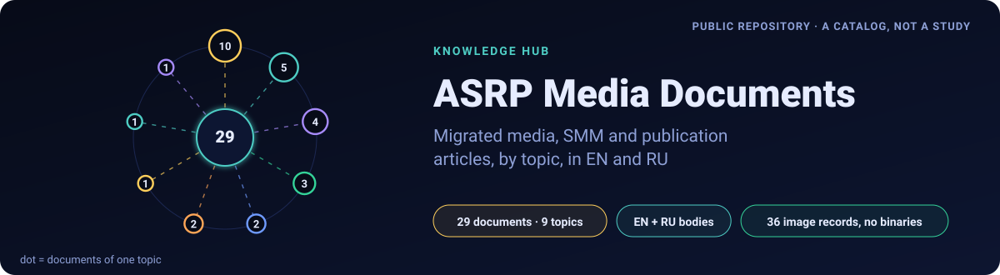
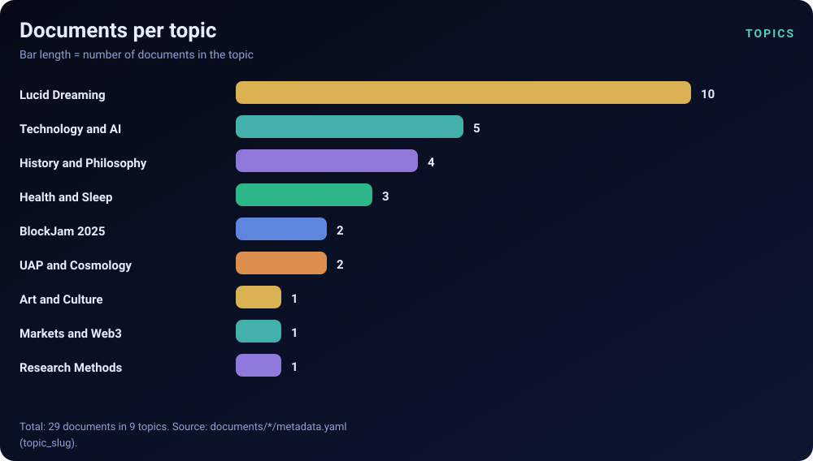
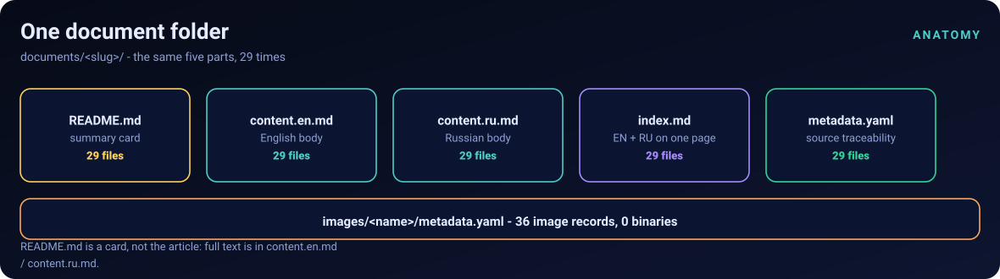
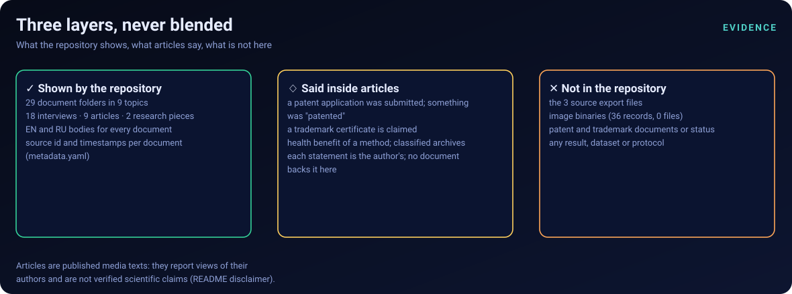

<p align="right"><b>English</b> · <a href="README.ru.md">Русский</a></p>

<p align="center"></p>

# ASRP MEDIA DOCUMENTS KNOWLEDGE HUB

**Bilingual navigation hub for migrated ASRP media, SMM, and publication articles (EN / RU).**
This repository is a media/knowledge catalog. It is **not** an experimental study and holds no protocols, datasets or results.

<p align="center">
    
</p>

| Repository / Репозиторий | Status / Статус |
|---|---|
| `asrp.media-documents` | ACTIVE / АКТИВЕН |

**Organization / Организация:** Advanced Scientific Research Projects (ASRP) · **Part of Advanced Scientific Research Projects (ASRP) Ecosystem / Часть Экосистемы Advanced Scientific Research Projects (ASRP)**

[](https://github.com/AdvancedScientificResearchProjects)
[]()
[]()
[]()

[](https://asrp.tech/en/patrons)

> **EN:** **If this work is valuable to you — support us.** 7 patron tiers from Principal Philanthropist to Individual Contributor.
> **Support:** <https://asrp.tech/en/patrons>
> **Investment inquiries:** _pending — provide URL when available_

<!-- legacy-anchors --><a name="asrp-media-documents-knowledge-hub"></a><a name="хаб-медиа-документов-asrp"></a>
## At a glance

| | |
|---|---|
| **What it is** | a hub of **29 migrated documents**: 18 interviews, 9 articles, 2 research pieces |
| **Topics** | 9 topics; the biggest is Lucid Dreaming (10 documents) |
| **Languages** | an English and a Russian body for every document; both together on one `index.md` page |
| **Source status** | 4 documents `published`, 25 `todo` in the platform export (status as copied, not interpreted) |
| **Images** | 36 image metadata records, no image files |
| **Not in this repository** | results, datasets, protocols, patent documents, the source export files |
| **Visibility** | public |



<!-- legacy-anchors --><a name="quick-navigation--быстрая-навигация"></a>
## Quick navigation

| | Section | What you get | Page |
|---|---|---|---|
|  | What this hub is | origin, migration rules, what was left out | [guide/HUB.md](guide/HUB.md) |
|  | Documents by topic | 9 topics, source types and statuses | [guide/TOPICS.md](guide/TOPICS.md) |
|  | Structure and how to read it | folder tree, one document folder, metadata keys | [guide/NAVIGATION.md](guide/NAVIGATION.md) |
|  | Claims and evidence | what the repository shows vs what articles say | [guide/CLAIMS.md](guide/CLAIMS.md) |
|  | Ecosystem and patent applications | related repositories, application numbers, contacts | [guide/ECOSYSTEM.md](guide/ECOSYSTEM.md) |
|  | Open questions | inconsistencies found in the repository | [guide/OPEN-QUESTIONS.md](guide/OPEN-QUESTIONS.md) |
|  | Figures | every picture and diagram | [guide/FIGURES.md](guide/FIGURES.md) |
|  | Previous README | kept byte for byte | [archive/README_2026-11-19_pre-showcase.md](archive/README_2026-11-19_pre-showcase.md) |

Guide index: [guide/README.md](guide/README.md).

<!-- legacy-anchors --><a name="overview--обзор"></a><a name="english"></a><a name="русский"></a>
## What this hub is

This repository is a **bilingual (EN / RU) navigation hub** for **29 migrated ASRP media, SMM, and publication articles**. It is a media/knowledge catalog, **not** an experimental study — there are no protocols or experimental-design sections here.

Each migrated article lives in its own `documents/<slug>/` folder with a summary-card `README.md`, full bodies as `content.en.md` and/or `content.ru.md`, a traceability `metadata.yaml`, and image-metadata folders. Article bodies are preserved only for English and Russian source content; other languages from the original exports were intentionally not migrated. Image binaries were not present in the export, so image folders record metadata only (source paths and usage context).

Navigation is topic-first: the **Topics index** and the **Documents catalog** are the central entry points. The hub groups the 29 documents across 9 practical themes — from lucid dreaming and sleep physiology to BlockJam 2025, Web3/markets, and UAP/cosmology.

Full page: [guide/HUB.md](guide/HUB.md)

<!-- legacy-anchors --><a name="documents-by-topic--документы-по-темам"></a>
## Documents by topic

| Topic | Docs | Lead file |
|---|---:|---|
| Lucid Dreaming | 10 | [`topics/lucid-dreaming.md`](topics/lucid-dreaming.md) |
| Technology and AI | 5 | [`topics/technology-and-ai.md`](topics/technology-and-ai.md) |
| History and Philosophy | 4 | [`topics/history-and-philosophy.md`](topics/history-and-philosophy.md) |
| Health and Sleep | 3 | [`topics/health-and-sleep.md`](topics/health-and-sleep.md) |
| BlockJam 2025 | 2 | [`topics/blockjam-2025.md`](topics/blockjam-2025.md) |
| UAP and Cosmology | 2 | [`topics/uap-and-cosmology.md`](topics/uap-and-cosmology.md) |
| Art and Culture | 1 | [`topics/art-and-culture.md`](topics/art-and-culture.md) |
| Markets and Web3 | 1 | [`topics/markets-and-web3.md`](topics/markets-and-web3.md) |
| Research Methods | 1 | [`topics/research-methods.md`](topics/research-methods.md) |
| **Total** | **29** | [`topics/README.md`](topics/README.md) |

Open any topic page for the list of articles in that theme, or use the full catalog below for the complete per-document index with source IDs, types, and status.

Full page: [guide/TOPICS.md](guide/TOPICS.md)

<!-- legacy-anchors --><a name="documents-catalog--каталог-документов"></a>
## Documents catalog

The complete catalog of all **29** migrated documents — each with a summary card and full EN / RU bodies — lives in [`documents/README.md`](documents/README.md). The catalog lists title, source type (`interview` / `article` / `research`), source status (`published` / `todo`), topic, available languages, and source ID.

- **Interviews:** 18 · **Articles:** 9 · **Research:** 2
- **Source status `published`:** 4 · **Source status `todo`:** 25
- **Available translations:** English (EN) and Russian (RU) for every document

Full page: [guide/TOPICS.md](guide/TOPICS.md)

<!-- legacy-anchors --><a name="structure--структура"></a>
## Structure

```
asrp.media-documents/
├── README.md, README.ru.md       # front pages (EN, RU)
├── metadata.yaml                 # machine-readable hub metadata
├── documents/
│   ├── README.md                 # full documents catalog
│   └── <slug>/                   # one folder per article (29)
│       ├── README.md             # summary card
│       ├── content.en.md         # English body
│       ├── content.ru.md         # Russian body
│       ├── index.md              # both languages on one page
│       ├── metadata.yaml         # source traceability
│       └── images/<slug>/metadata.yaml   # image metadata only (no binaries)
├── topics/                       # README.md = topics index, <topic>.md = one page per topic (9)
├── guide/                        # showcase pages (EN + RU) and generated SVG
├── archive/                      # the previous README, byte for byte
├── tools/, tests/                # showcase tooling and the no-loss gate
```

Each `documents/<slug>/` folder is self-contained. `README.md` files are summary cards, not full article bodies — full bodies live in `content.en.md` / `content.ru.md`. `metadata.yaml` files preserve source traceability (export filenames, source IDs, language rows). Source exports referenced by traceability: `documents_202606241032.json`, `documents_content_202606241032.json`, `document_draft_contents_202606241032.json`.



Full page: [guide/NAVIGATION.md](guide/NAVIGATION.md)

## Claims and evidence

The articles are published media texts. What the repository itself shows is its structure and traceability; what the articles say (a patent application, a trademark certificate, health benefits of a method, "classified archives") is attributed to their authors and is not backed by a document in this repository. An application is not a granted patent.



Full page: [guide/CLAIMS.md](guide/CLAIMS.md)

<!-- legacy-anchors --><a name="security--безопасность"></a><a name="data-classification--классификация-данных"></a>
## Security

### Data Classification

| Level | Access | Marking | Description |
|---|---|---|---|
| **PUBLIC** | Open | GREEN | General information |
| **RESEARCH** | Team Only | YELLOW | Research data |
| **RESTRICTED** | Core Team | RED | Sensitive analysis |
| **INTERNAL** | Director Only | BLACK | Director-level review only |

> **EN:** Migrated article bodies (`content.en.md` / `content.ru.md`) are **PUBLIC** — they are editorial/educational media content cleared for public reading. Source `metadata.yaml` records export traceability only; it contains no personal data beyond source IDs and publication timestamps.

The repository metadata carries `data_classification: INTERNAL`, while the repository itself is public: see [guide/OPEN-QUESTIONS.md](guide/OPEN-QUESTIONS.md).

<!-- legacy-anchors --><a name="asrp-ecosystem--экосистема-asrp"></a><a name="related-research-repositories--связанные-исследовательские-репозитории"></a><a name="patent-portfolio--патентный-портфель"></a>
## ASRP ecosystem

### Related Research Repositories

| Repository | Direction | Link |
|---|---|---|
| **ASRP.media (publication platform)** | Media & SMM articles source | _referenced via migrated `source_id` traceability in each `metadata.yaml`_ |
| **Hyperbolic Field Agricultural Study** | Plant & seed growth | [View](https://github.com/AdvancedScientificResearchProjects/Hyperbolic_Field_Agricultural_Study) |
| **UAP Reverse Engineering Study** | Multi-track UAP research hub | [View](https://github.com/AdvancedScientificResearchProjects/UAP_Reverse_Engineering_Study) |
| **ASRP.art** | Art & consciousness | [View](https://github.com/AdvancedScientificResearchProjects/Axionetic_Sensing_Reactions_Platform_in_Art) |

### Patent Portfolio — patent applications as listed by the old README

> **EN:** This hub is a media/knowledge catalog and is **not itself** the IP basis for any filing. The old README says: "Several migrated articles cover ASRP research programs that **are** patent-grounded; their canonical patents are listed below. No patent filing directly grounds this catalog." The numbers below are application numbers; **an application is not a granted patent**, and this repository holds no patent document, no filing status and does not name the applicants.

| Programme | Application | Link |
|---|---|---|
| **ASRP.art** | KZ 2025/0592.1 + PCT | [View](https://github.com/denisbanchenko/Kazpatent_Axionetic_Sensing_Reactions_Platform_in_Art_Patent) |
| **ASRP.drift** | KZ 413554 | [View](https://github.com/denisbanchenko/Kazpatent_Advanced_Synchro_Resonance_Platform_For_Deep_Resonant_Patent) |
| **Fractal Biomedical System** | KZ 2025/1095.1 | [View](https://github.com/denisbanchenko/Kazpatent_Fractal_Biomedical_System_Patent) |
| **Global Forecasting System (GFS)** | KZ 2025/1096.1 | [View](https://github.com/denisbanchenko/Kazpatent_Global_Forecasting_System_Patent) |

Full page: [guide/ECOSYSTEM.md](guide/ECOSYSTEM.md)

> **Support:** if this work is valuable to you — https://asrp.tech/en/patrons

<!-- legacy-anchors --><a name="contact-information--контактная-информация"></a><a name="corporate-contact--корпоративные-контакты"></a>
## Contact

### Corporate Contact

| Field | Value |
|---|---|
| **Organization** | ТОО "Перспективные Научно-Исследовательские Разработки" / Advanced Scientific Research Projects LLP |
| **Country** | Republic of Kazakhstan |
| **Website** | [asrp.tech](https://asrp.tech) |
| **Email** | info@asrp.tech |

| Purpose | Contact |
|---|---|
| **General Inquiries** | info@asrp.tech |
| **Research Collaboration** | info@asrp.tech |
| **Security Issues** | info@asrp.tech |

> **EN:** Contact uses the organization e-mail `info@asrp.tech` only. No member's personal/home address or personal contact details are published here. The organization named here is a contact; this page does not say who holds any patent or application.

## Open questions

Seven open questions are listed in [guide/OPEN-QUESTIONS.md](guide/OPEN-QUESTIONS.md) (classification vs visibility, meaning of `todo`, missing exports and more).

<!-- legacy-anchors --><a name="disclaimer--отказ-от-ответственности"></a><a name="english-1"></a><a name="русский-1"></a>
## Disclaimer

This repository is a media/knowledge catalog of migrated editorial articles. Article content reflects its original authors and publication context; it is presented for documentation and navigation, not as verified scientific claims.

---

**Last Updated:** July 2026
**Status:** The hub actively catalogs 29 migrated bilingual articles across 9 topics.

**ASRP RESEARCH STANDARD v2.1**

<!-- legacy-anchors --><a name="navigation-index--навигационный-индекс"></a>
## Navigation index

[At a glance](#at-a-glance) · [Quick navigation](#quick-navigation) · [What this hub is](#what-this-hub-is) · [Documents by topic](#documents-by-topic) · [Documents catalog](#documents-catalog) · [Structure](#structure) · [Claims and evidence](#claims-and-evidence) · [Security](#security) · [ASRP ecosystem](#asrp-ecosystem) · [Contact](#contact) · [Disclaimer](#disclaimer) · [Русская версия](README.ru.md)
