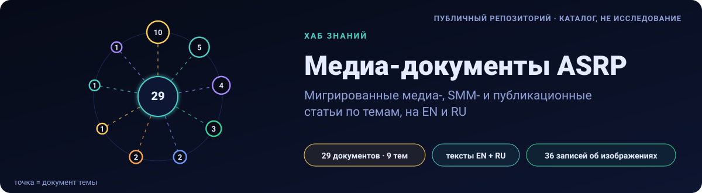
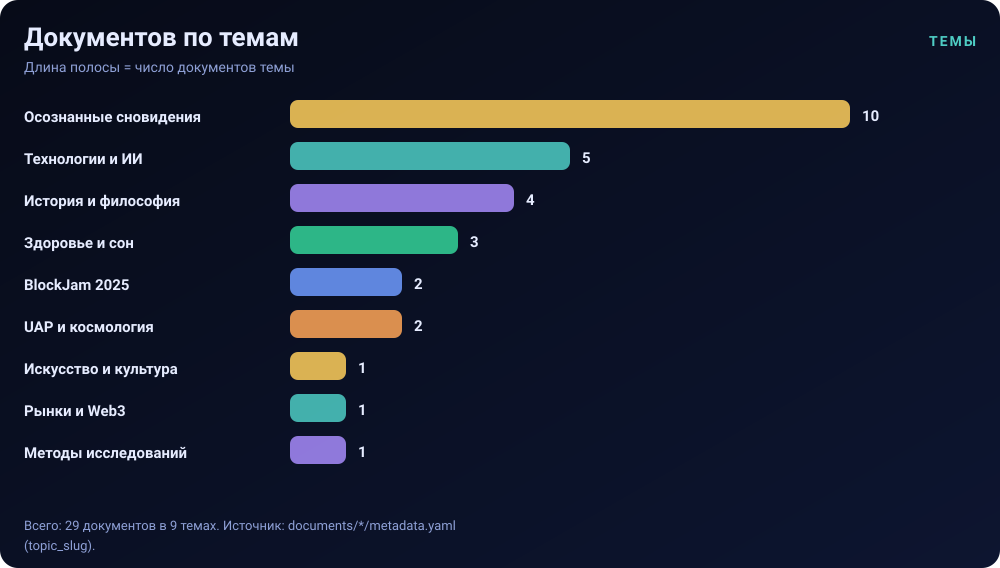
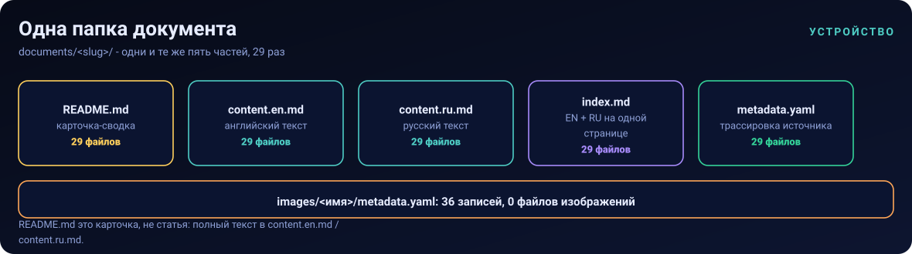
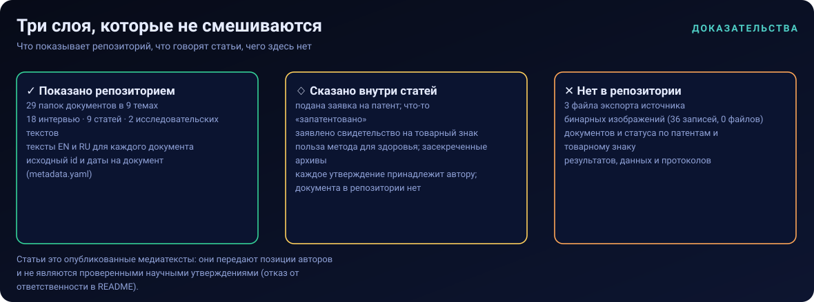

<p align="right"><a href="README.md">English</a> · <b>Русский</b></p>

<p align="center"></p>

# ХАБ МЕДИА-ДОКУМЕНТОВ ASRP

**Двуязычный навигационный хаб мигрированных медиа-, SMM- и публикационных статей ASRP (EN / RU).**
Этот репозиторий — медиа-/знаниевый каталог. Это **не** экспериментальное исследование: протоколов, данных и результатов здесь нет.

<p align="center">
    
</p>

| Repository / Репозиторий | Status / Статус |
|---|---|
| `asrp.media-documents` | ACTIVE / АКТИВЕН |

**Organization / Организация:** Advanced Scientific Research Projects (ASRP) · **Часть Экосистемы Advanced Scientific Research Projects (ASRP)**

[](https://github.com/AdvancedScientificResearchProjects)
[]()
[]()
[]()

[](https://asrp.tech/en/patrons)

> **RU:** **Если эта работа вам полезна — поддержите нас.** 7 уровней меценатства — от Главного Филантропа до Индивидуального Вкладчика.
> **Поддержать:** <https://asrp.tech/en/patrons>
> **Инвестиционные запросы:** _в ожидании — добавляется при предоставлении_

<!-- legacy-anchors --><a name="asrp-media-documents-knowledge-hub"></a><a name="хаб-медиа-документов-asrp"></a>
## Коротко

| | |
|---|---|
| **Что это** | хаб из **29 мигрированных документов**: 18 интервью, 9 статей, 2 исследовательских текста |
| **Темы** | 9 тем; самая большая — осознанные сновидения (10 документов) |
| **Языки** | английский и русский текст у каждого документа; оба вместе на одной странице `index.md` |
| **Статус источника** | 4 документа `published`, 25 `todo` в экспорте платформы (статус скопирован, не истолкован) |
| **Изображения** | 36 записей о метаданных изображений, файлов изображений нет |
| **Нет в репозитории** | результатов, данных, протоколов, патентных документов, файлов экспорта источника |
| **Видимость** | публичный |



<!-- legacy-anchors --><a name="quick-navigation--быстрая-навигация"></a>
## Быстрая навигация

| | Раздел | Что внутри | Страница |
|---|---|---|---|
|  | Что это за хаб | происхождение, правила миграции, что не вошло | [guide/HUB.ru.md](guide/HUB.ru.md) |
|  | Документы по темам | 9 тем, типы и статусы источника | [guide/TOPICS.ru.md](guide/TOPICS.ru.md) |
|  | Структура и как её читать | дерево папок, папка документа, ключи метаданных | [guide/NAVIGATION.ru.md](guide/NAVIGATION.ru.md) |
|  | Заявления и доказательства | что показывает репозиторий и что говорят статьи | [guide/CLAIMS.ru.md](guide/CLAIMS.ru.md) |
|  | Экосистема и патентные заявки | связанные репозитории, номера заявок, контакты | [guide/ECOSYSTEM.ru.md](guide/ECOSYSTEM.ru.md) |
|  | Открытые вопросы | несостыковки в репозитории | [guide/OPEN-QUESTIONS.ru.md](guide/OPEN-QUESTIONS.ru.md) |
|  | Иллюстрации | все картинки и диаграммы | [guide/FIGURES.ru.md](guide/FIGURES.ru.md) |
|  | Прежний README | сохранён байт в байт | [archive/README_2026-11-19_pre-showcase.md](archive/README_2026-11-19_pre-showcase.md) |

Индекс руководства: [guide/README.ru.md](guide/README.ru.md).

<!-- legacy-anchors --><a name="overview--обзор"></a><a name="english"></a><a name="русский"></a>
## Что это за хаб

Этот репозиторий — **двуязычный (EN / RU) навигационный хаб** для **29 мигрированных медиа-, SMM- и публикационных статей ASRP**. Это медиа-/знаниевый каталог, **а не** экспериментальное исследование — здесь нет протоколов или разделов с планом экспериментов.

Каждая мигрированная статья находится в собственной папке `documents/<slug>/` с карточкой-сводкой `README.md`, полными текстами `content.en.md` и/или `content.ru.md`, файлом трассировки `metadata.yaml` и папками с метаданными изображений. Тексты статей сохранены только для англо- и русскоязычного исходного контента; прочие языки из исходных экспортов намеренно не мигрировались. Бинарные файлы изображений отсутствовали в экспорте, поэтому папки изображений содержат только метаданные (исходные пути и контекст использования).

Навигация построена от тем: **Индекс тем** и **Каталог документов** — центральные точки входа. Хаб распределяет 29 документов по 9 практическим темам — от осознанных сновидений и физиологии сна до BlockJam 2025, Web3/рынков и UAP/космологии.

Полная страница: [guide/HUB.ru.md](guide/HUB.ru.md)

<!-- legacy-anchors --><a name="documents-by-topic--документы-по-темам"></a>
## Документы по темам

| Тема | Документов | Главный файл |
|---|---:|---|
| Осознанные сновидения | 10 | [`topics/lucid-dreaming.md`](topics/lucid-dreaming.md) |
| Технологии и ИИ | 5 | [`topics/technology-and-ai.md`](topics/technology-and-ai.md) |
| История и философия | 4 | [`topics/history-and-philosophy.md`](topics/history-and-philosophy.md) |
| Здоровье и сон | 3 | [`topics/health-and-sleep.md`](topics/health-and-sleep.md) |
| BlockJam 2025 | 2 | [`topics/blockjam-2025.md`](topics/blockjam-2025.md) |
| UAP и космология | 2 | [`topics/uap-and-cosmology.md`](topics/uap-and-cosmology.md) |
| Искусство и культура | 1 | [`topics/art-and-culture.md`](topics/art-and-culture.md) |
| Рынки и Web3 | 1 | [`topics/markets-and-web3.md`](topics/markets-and-web3.md) |
| Методы исследований | 1 | [`topics/research-methods.md`](topics/research-methods.md) |
| **Всего** | **29** | [`topics/README.md`](topics/README.md) |

Откройте страницу темы, чтобы увидеть список статей в ней, либо воспользуйтесь полным каталогом ниже для индекса по всем документам с исходными ID, типами и статусом.

Полная страница: [guide/TOPICS.ru.md](guide/TOPICS.ru.md)

<!-- legacy-anchors --><a name="documents-catalog--каталог-документов"></a>
## Каталог документов

Полный каталог всех **29** мигрированных документов — с карточкой-сводкой и полными текстами EN / RU — находится в [`documents/README.md`](documents/README.md). В каталоге указаны название, тип источника (`interview` / `article` / `research`), статус источника (`published` / `todo`), тема, доступные языки и исходный ID.

- **Интервью:** 18 · **Статьи:** 9 · **Исследования:** 2
- **Опубликовано в источнике (`published`):** 4 · **В работе в источнике (`todo`):** 25
- **Доступные переводы:** английский (EN) и русский (RU) для каждого документа

Полная страница: [guide/TOPICS.ru.md](guide/TOPICS.ru.md)

<!-- legacy-anchors --><a name="structure--структура"></a>
## Структура

```
asrp.media-documents/
├── README.md, README.ru.md       # главные страницы (EN, RU)
├── metadata.yaml                 # машинно-читаемые метаданные хаба
├── documents/
│   ├── README.md                 # полный каталог документов
│   └── <slug>/                   # папка на статью (29)
│       ├── README.md             # карточка-сводка
│       ├── content.en.md         # английский текст
│       ├── content.ru.md         # русский текст
│       ├── index.md              # оба языка на одной странице
│       ├── metadata.yaml         # трассировка источника
│       └── images/<slug>/metadata.yaml   # только метаданные изображений (без бинарных файлов)
├── topics/                       # README.md = индекс тем, <topic>.md = страница темы (9)
├── guide/                        # страницы витрины (EN + RU) и сгенерированные SVG
├── archive/                      # прежний README, байт в байт
├── tools/, tests/                # инструменты витрины и проверка без потерь
```

Каждая папка `documents/<slug>/` самодостаточна. Файлы `README.md` — это карточки-сводки, а не полные тексты статей; полные тексты находятся в `content.en.md` / `content.ru.md`. Файлы `metadata.yaml` сохраняют трассировку источника (имена файлов экспорта, исходные ID, языковые строки). Экспорты-источники, на которые ссылается трассировка: `documents_202606241032.json`, `documents_content_202606241032.json`, `document_draft_contents_202606241032.json`.



Полная страница: [guide/NAVIGATION.ru.md](guide/NAVIGATION.ru.md)

## Заявления и доказательства

Статьи — опубликованные медиатексты. Репозиторий сам показывает свою структуру и трассировку; то, что говорят статьи (патентная заявка, свидетельство на товарный знак, польза метода для здоровья, «закрытые архивы»), приписано их авторам и не подтверждено документом в этом репозитории. Заявка не является патентом.



Полная страница: [guide/CLAIMS.ru.md](guide/CLAIMS.ru.md)

<!-- legacy-anchors --><a name="security--безопасность"></a><a name="data-classification--классификация-данных"></a>
## Безопасность

### Классификация данных

| Уровень | Доступ | Маркировка | Описание |
|---|---|---|---|
| **ПУБЛИЧНЫЙ** | Открытый | ЗЕЛЁНЫЙ | Общая информация |
| **ИССЛЕДОВАТЕЛЬСКИЙ** | Только команда | ЖЁЛТЫЙ | Исследовательские данные |
| **ОГРАНИЧЕННЫЙ** | Основная команда | КРАСНЫЙ | Конфиденциальный анализ |
| **ВНУТРЕННИЙ** | Только директор | ЧЁРНЫЙ | Только обзор уровня директора |

> **RU:** Тексты статей (`content.en.md` / `content.ru.md`) имеют уровень **ПУБЛИЧНЫЙ** — это редакционный/образовательный медиаконтент, разрешённый для публичного чтения. Файлы `metadata.yaml` содержат только трассировку экспорта; в них нет персональных данных помимо исходных ID и временных меток публикации.

В метаданных репозитория стоит `data_classification: INTERNAL`, при этом сам репозиторий публичный: см. [guide/OPEN-QUESTIONS.ru.md](guide/OPEN-QUESTIONS.ru.md).

<!-- legacy-anchors --><a name="asrp-ecosystem--экосистема-asrp"></a><a name="related-research-repositories--связанные-исследовательские-репозитории"></a><a name="patent-portfolio--патентный-портфель"></a>
## Экосистема ASRP

### Связанные исследовательские репозитории

| Репозиторий | Направление | Ссылка |
|---|---|---|
| **Платформа публикаций ASRP.media** | Источник медиа- и SMM-статей | _ссылается через исходные `source_id` в каждом `metadata.yaml`_ |
| **Сельскохозяйственное исследование (Hyperbolic Field Agricultural Study)** | Рост растений и семян | [Просмотр](https://github.com/AdvancedScientificResearchProjects/Hyperbolic_Field_Agricultural_Study) |
| **Исследование по реверс-инжинирингу НАЯ (UAP Reverse Engineering Study)** | Многотрековый хаб исследований НАЯ | [Просмотр](https://github.com/AdvancedScientificResearchProjects/UAP_Reverse_Engineering_Study) |
| **ASRP.art** | Искусство и сознание | [Просмотр](https://github.com/AdvancedScientificResearchProjects/Axionetic_Sensing_Reactions_Platform_in_Art) |

### Патентный портфель — патентные заявки из прежнего README

> **RU:** Этот хаб — медиа-/знаниевый каталог и **сам по себе** не является основанием какой-либо заявки. Прежний README говорит: «Ряд мигрированных статей освещает исследовательские программы ASRP, имеющие патентную основу; их канонические патенты приведены ниже. Патентная заявка не лежит в основе данного каталога.» Ниже — номера заявок; **заявка не является патентом**; в репозитории нет патентных документов и статуса подачи, и он не называет заявителей.

| Программа | Заявка | Ссылка |
|---|---|---|
| **ASRP.art / ПНИР.искусство** | KZ 2025/0592.1 + PCT | [Просмотр](https://github.com/denisbanchenko/Kazpatent_Axionetic_Sensing_Reactions_Platform_in_Art_Patent) |
| **ASRP.drift / ПНИР.дрифт** | KZ 413554 | [Просмотр](https://github.com/denisbanchenko/Kazpatent_Advanced_Synchro_Resonance_Platform_For_Deep_Resonant_Patent) |
| **Фрактальная биомедицинская система** | KZ 2025/1095.1 | [Просмотр](https://github.com/denisbanchenko/Kazpatent_Fractal_Biomedical_System_Patent) |
| **Глобальная система прогнозирования (GFS)** | KZ 2025/1096.1 | [Просмотр](https://github.com/denisbanchenko/Kazpatent_Global_Forecasting_System_Patent) |

Полная страница: [guide/ECOSYSTEM.ru.md](guide/ECOSYSTEM.ru.md)

> **Поддержать:** если эта работа вам полезна — https://asrp.tech/en/patrons

<!-- legacy-anchors --><a name="contact-information--контактная-информация"></a><a name="corporate-contact--корпоративные-контакты"></a>
## Контакты

### Корпоративные контакты

| Поле | Значение |
|---|---|
| **Организация** | ТОО "Перспективные Научно-Исследовательские Разработки" / Advanced Scientific Research Projects LLP |
| **Страна** | Республика Казахстан |
| **Веб-сайт** | [asrp.tech](https://asrp.tech) |
| **Email** | info@asrp.tech |

| Цель | Контакт |
|---|---|
| **Общие вопросы** | info@asrp.tech |
| **Научное сотрудничество** | info@asrp.tech |
| **Безопасность** | info@asrp.tech |

> **RU:** Для связи используется только e-mail организации `info@asrp.tech`. Личные/домашние адреса или личные контакты участников здесь не публикуются. Названная здесь организация — контакт; страница не говорит, кому принадлежит какой-либо патент или заявка.

## Открытые вопросы

Семь открытых вопросов перечислены в [guide/OPEN-QUESTIONS.ru.md](guide/OPEN-QUESTIONS.ru.md) (классификация и видимость, значение `todo`, отсутствующие файлы экспорта и другое).

<!-- legacy-anchors --><a name="disclaimer--отказ-от-ответственности"></a><a name="english-1"></a><a name="русский-1"></a>
## Отказ от ответственности

Этот репозиторий — медиа-/знаниевый каталог мигрированных редакционных статей. Содержание статей отражает позиции их авторов и контекст публикации; оно представлено для документирования и навигации, а не как проверенные научные утверждения.

---

**Последнее обновление:** July 2026
**Статус:** Хаб активно каталогизирует 29 мигрированных двуязычных статей по 9 темам.

**ASRP RESEARCH STANDARD v2.1**

<!-- legacy-anchors --><a name="navigation-index--навигационный-индекс"></a>
## Навигационный индекс

[Коротко](#коротко) · [Быстрая навигация](#быстрая-навигация) · [Что это за хаб](#что-это-за-хаб) · [Документы по темам](#документы-по-темам) · [Каталог документов](#каталог-документов) · [Структура](#структура) · [Заявления и доказательства](#заявления-и-доказательства) · [Безопасность](#безопасность) · [Экосистема ASRP](#экосистема-asrp) · [Контакты](#контакты) · [Отказ от ответственности](#отказ-от-ответственности) · [English](README.md)
