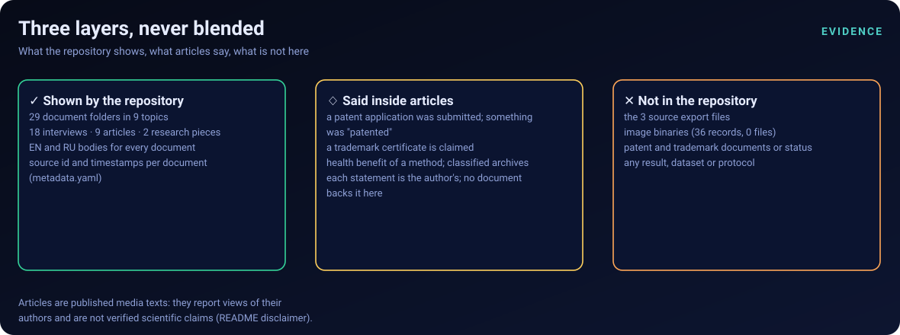

# Claims and evidence

[Guide](README.md) · [Русский](CLAIMS.ru.md) · [Front page](../README.md)

The articles are published media texts. This page separates three things and never blends them: what the repository **shows** (structure, counts, traceability), what the articles **say** (attributed to their authors), and what is **not here** (documents that would back those statements). An application is not a granted patent.

## What the repository shows

| Fact | Source |
|---|---|
| 29 document folders, 9 topics, 18 interviews, 9 articles, 2 research pieces | `metadata.yaml` (`migrated_documents_count: 29`, `topics_count: 9`, `source_type_counts`) |
| English and Russian bodies for every document | `documents/*/content.en.md`, `content.ru.md` |
| Source id and timestamps per document | `documents/*/metadata.yaml` |
| No image files, metadata only | `documents/*/images/*/metadata.yaml` (`binary_in_export: false`) |
| The hub declares no filing of its own | `metadata.yaml`: `patent_filing: none` |

## What the articles say (statement, quote, evidence in the repository)

| Statement | Where | Verbatim quote | Evidence here |
|---|---|---|---|
| A trademark certificate exists | `documents/asrpart-the-awakening-of-art-or-how-dreams-become-the-soul-of-the-canvas/content.en.md:43` | "officially registered trademark, certificate No. 94456" | none: no certificate in the repository; a trademark, not a patent |
| A patent application was submitted | same file, line 53 | "a patent application has already been submitted to" | none: no application document, number or status |
| Something was patented | `documents/cybernetics-space-and-microflora-professor-samuel-gorelik-on-studying-sleep-physiology-using-mathematical-models/content.en.md:103` | "We have written a lot about this, patented it, and are currently implementing it." | none: no patent number or document |
| A method has a positive health effect | `documents/README.md:12` (title) and `documents/the-banchenko-algorithm-a-method-for-stimulating-lucid-dreaming-that-has-a-positive-impact-on-health/content.en.md:15` | "positive impact on health"; "The personal experience of the study participants confirms the possibility of applying this algorithm" | none: no data, protocol or measurement; participant experience only |
| The article says an interview was recorded on 28 September 2021 and kept in "classified archives" | `documents/dubna-against-or-together-with-area-s4-eg-g-and-its-successors-as-one-of-the-elements-of-the-global-project-on-reverse-e/content.en.md:13` | "In the classified archives of the alliance"; "there was an interview recorded on" | none: no archive or recording is in the repository |
| Illegal infrastructure for extraterrestrial artifacts exists | `documents/ot-temnoj-storony-sily-k-svetu-znaniy-novogo-vremeni-intervyu-s-denisom-banchenko/content.en.md:203` | "An illegal parallel civilizational infrastructure operates on Earth" | none: an interviewee's assertion |
| (an interviewee's own caveat) | `documents/hyperbolic-fields-and-pyramids-of-giza-how-ancient-civilizations-influenced-time-and-space/content.en.md:41` | "We have not reached a level in our research to make such unambiguous conclusions" | the caveat is in the source |

## What the old README said

The old README says: "Several migrated articles cover ASRP research programs that **are** patent-grounded; their canonical patents are listed below." The repository contains no patent document and no filing status; what is listed are application numbers (see [ECOSYSTEM.md](ECOSYSTEM.md)). The sentence is quoted here, not adopted as a fact.

## What is not in the repository

The three source export files; image files; patent, application or trademark documents; any dataset, protocol or result; peer review of any kind (the words "peer-reviewed" occur nowhere in the tree).

The README disclaimer applies to all of the above: article content is "presented for documentation and navigation, not as verified scientific claims".
