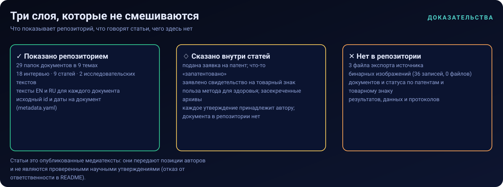

# Заявления и доказательства

[Руководство](README.ru.md) · [English](CLAIMS.md) · [Главная страница](../README.ru.md)

Статьи — опубликованные медиатексты. Страница разделяет три вещи и не смешивает их: что **показывает** репозиторий (структура, числа, трассировка), что **говорят** статьи (приписано их авторам) и чего **здесь нет** (документов, которые подтвердили бы эти заявления). Заявка не является патентом.

## Что показывает репозиторий

| Факт | Источник |
|---|---|
| 29 папок документов, 9 тем, 18 интервью, 9 статей, 2 исследовательских текста | `metadata.yaml` (`migrated_documents_count: 29`, `topics_count: 9`, `source_type_counts`) |
| Английский и русский тексты у каждого документа | `documents/*/content.en.md`, `content.ru.md` |
| Исходный id и даты на документ | `documents/*/metadata.yaml` |
| Нет файлов изображений, только метаданные | `documents/*/images/*/metadata.yaml` (`binary_in_export: false`) |
| Хаб не заявляет собственной заявки | `metadata.yaml`: `patent_filing: none` |

## Что говорят статьи (заявление, цитата, подтверждение в репозитории)

| Заявление | Где | Цитата дословно | Подтверждение здесь |
|---|---|---|---|
| Существует свидетельство на товарный знак | `documents/asrpart-the-awakening-of-art-or-how-dreams-become-the-soul-of-the-canvas/content.ru.md:43` | «официально зарегестрированный товарный знак, свидетельство №94456» | нет: свидетельства в репозитории нет; это товарный знак, не патент |
| Подана заявка на патент | тот же файл, строка 53 | «уже подана заявка на патент в» | нет: ни документа заявки, ни номера, ни статуса |
| Что-то запатентовано | `documents/cybernetics-space-and-microflora-professor-samuel-gorelik-on-studying-sleep-physiology-using-mathematical-models/content.ru.md:103` | «Об этом мы много написали, запатентовали их, внедряем сейчас.» | нет: ни номера патента, ни документа |
| Метод положительно влияет на здоровье | `documents/README.md:12` (название) и `documents/the-banchenko-algorithm-a-method-for-stimulating-lucid-dreaming-that-has-a-positive-impact-on-health/content.ru.md:15` | «positive impact on health»; «Личный опыт участников исследования подтверждает возможность применения этого алгоритма» | нет: ни данных, ни протокола, ни измерений; только опыт участников |
| Интервью хранилось в закрытых архивах | `documents/dubna-against-or-together-with-area-s4-eg-g-and-its-successors-as-one-of-the-elements-of-the-global-project-on-reverse-e/content.ru.md:13` | «скрыв имена участников» | нет: интервью нельзя проверить по репозиторию |
| Существует нелегальная инфраструктура для внеземных артефактов | `documents/ot-temnoj-storony-sily-k-svetu-znaniy-novogo-vremeni-intervyu-s-denisom-banchenko/content.ru.md:203` | «На Земле действует нелегальная пара цивилизационная инфраструктура» | нет: утверждение собеседника |
| (оговорка самого собеседника) | `documents/hyperbolic-fields-and-pyramids-of-giza-how-ancient-civilizations-influenced-time-and-space/content.ru.md:41` | «Мы не достигли в своих исследованиях того уровня, чтобы делать такие однозначные заключения» | оговорка есть в источнике |

## Что говорил прежний README

Прежний README говорит: «Ряд мигрированных статей освещает исследовательские программы ASRP, имеющие патентную основу; их канонические патенты приведены ниже.» В репозитории нет ни патентного документа, ни статуса заявки; перечислены номера заявок (см. [ECOSYSTEM.ru.md](ECOSYSTEM.ru.md)). Предложение здесь процитировано, а не принято как факт.

## Чего нет в репозитории

Три файла экспорта источника; файлы изображений; документы о патентах, заявках и товарном знаке; любые данные, протоколы и результаты; рецензирование любого рода (слово «peer-reviewed» нигде в дереве не встречается).

Отказ от ответственности из README относится ко всему перечисленному: содержание статей представлено «для документирования и навигации, а не как проверенные научные утверждения».
