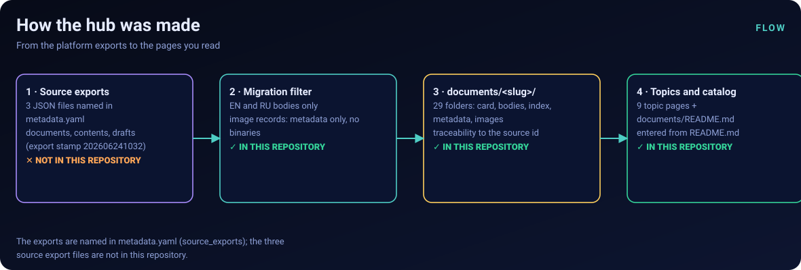

# What this hub is

[Guide](README.md) · [Русский](HUB.ru.md) · [Front page](../README.md)

## In one paragraph

`asrp.media-documents` is a **bilingual (EN / RU) navigation hub** for **29 migrated ASRP media, SMM, and publication articles** (18 interviews, 9 articles, 2 research pieces). It is a media/knowledge catalog, **not** an experimental study. The repository is public.

## Where the documents came from

- The hub was built from three platform export files, named in `metadata.yaml` (`source_exports`): `documents_202606241032.json`, `documents_content_202606241032.json`, `document_draft_contents_202606241032.json`. They are **not stored here**: `.gitignore` lists `document*_*.json` and `documents*_*.json`. The three source export files are not in this repository.
- The first commit (2026-06-24) is "Build Markdown knowledge hub from exports". On 2026-07-17 a pre-publication template and bilingual `index.md` pages were added in four batches (29 `index.md` files in total). 12 commits in all, default branch `main`.
- The platform behind the articles is named in the old README as **ASRP.media (publication platform)**; the link to it is only the `source_id` in each `metadata.yaml`.

## What was migrated and what was not

- Article bodies exist **only in English and Russian** (29 + 29 files, about 71,660 and 60,058 whitespace-separated words); other languages of the exports were intentionally not migrated (`non_migrated_languages` in each `metadata.yaml` lists their ids).
- **Image binaries were not in the export.** The 36 image folders hold metadata only (source path, size, `binary_in_export: false`). There are no pictures in this repository.
- A deleted file in the git history, `migration-skipped.md` (removed in commit `f594ee5`), recorded which platform records were skipped: its summary reads "deleted: 1", "inactive: 76", "no published English/Russian content: 92", "test or placeholder title: 30" (categories overlap), and it lists 101 skipped records by id and title. Read it with `git show f594ee5^:migration-skipped.md`. The same file states the rule: the migration keeps "active, non-deleted documents with English or Russian published content".

## What it is good for

1. Finding an article by topic (9 topics) or by type (interview / article / research).
2. Reading the full text in English or Russian, or both on one page (`index.md`).
3. Tracing a document back to the platform record (`source_id`, timestamps, language rows).

## What it is not

It holds no protocols, datasets, results or patent documents; the old README disclaimer says: "Article content reflects its original authors and publication context; it is presented for documentation and navigation, not as verified scientific claims.". See [CLAIMS.md](CLAIMS.md).
