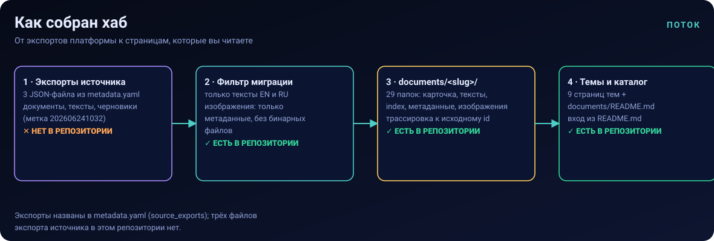

# Что это за хаб

[Руководство](README.ru.md) · [English](HUB.md) · [Главная страница](../README.ru.md)

## Коротко

`asrp.media-documents` — **двуязычный (EN / RU) навигационный хаб** для **29 мигрированных медиа-, SMM- и публикационных статей ASRP** (18 интервью, 9 статей, 2 исследовательских текста). Это медиа-/знаниевый каталог, **а не** экспериментальное исследование. Репозиторий публичный.

## Откуда взялись документы

- Хаб собран из трёх файлов экспорта платформы, названных в `metadata.yaml` (`source_exports`): `documents_202606241032.json`, `documents_content_202606241032.json`, `document_draft_contents_202606241032.json`. Здесь они **не хранятся**: `.gitignore` содержит `document*_*.json` и `documents*_*.json`. Поэтому миграцию из этого репозитория повторить нельзя.
- Первый коммит (2026-06-24) — «Build Markdown knowledge hub from exports». 2026-07-17 добавлены шаблон предпубликации и двуязычные страницы `index.md` четырьмя партиями (всего 29 файлов `index.md`). Всего 12 коммитов, одна ветка (`main`).
- Платформа, откуда статьи, названа в прежнем README как **ASRP.media (платформа публикаций)**; ссылка на неё — только `source_id` в каждом `metadata.yaml`.

## Что мигрировано и что нет

- Тексты статей есть **только на английском и русском** (29 + 29 файлов, около 71 660 и 60 058 слов, разделённых пробелами); остальные языки экспортов намеренно не мигрированы (`non_migrated_languages` в каждом `metadata.yaml` содержит их id).
- **Бинарных файлов изображений в экспорте не было.** 36 папок изображений содержат только метаданные (исходный путь, размер, `binary_in_export: false`). Картинок в репозитории нет.
- Удалённый файл в истории git, `migration-skipped.md` (удалён коммитом `f594ee5`), фиксировал, какие записи платформы пропущены: в сводке «deleted: 1», «inactive: 76», «no published English/Russian content: 92», «test or placeholder title: 30» (категории пересекаются), и перечислены 101 пропущенная запись по id и названию. Прочитать: `git show f594ee5^:migration-skipped.md`. Там же правило: миграция сохраняет «active, non-deleted documents with English or Russian published content».

## Для чего хаб годится

1. Найти статью по теме (9 тем) или по типу (interview / article / research).
2. Прочитать полный текст на английском или русском, либо оба на одной странице (`index.md`).
3. Проследить документ до записи платформы (`source_id`, даты, языковые строки).

## Чем хаб не является

Здесь нет протоколов, данных, результатов и патентных документов; прежний README в отказе от ответственности говорит: «Содержание статей отражает позиции их авторов и контекст публикации; оно представлено для документирования и навигации, а не как проверенные научные утверждения». См. [CLAIMS.ru.md](CLAIMS.ru.md).
