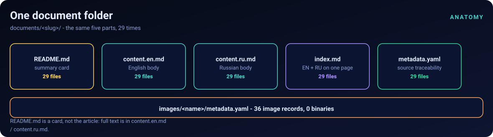

# Structure and how to read it

[Guide](README.md) · [Русский](NAVIGATION.ru.md) · [Front page](../README.md)

## Where to start

1. Know the subject: open [`topics/README.md`](../topics/README.md), pick a topic page, follow the link to a document card.
2. Want everything in one table: [`documents/README.md`](../documents/README.md).
3. Want to read: from the card open `content.en.md` or `content.ru.md`; `index.md` shows both languages on one page.
4. Want provenance: open the document's `metadata.yaml`.

## Folder tree

```
asrp.media-documents/
├── README.md, README.ru.md       # front pages (EN, RU)
├── metadata.yaml                 # machine-readable hub metadata
├── documents/
│   ├── README.md                 # full documents catalog
│   └── <slug>/                   # one folder per article (29)
├── topics/                       # topics index + 9 topic pages
├── guide/                        # these pages (EN + RU) and generated SVG
├── archive/                      # the previous README, byte for byte
├── tools/, tests/                # showcase tooling and the no-loss gate
```



## What one document folder holds

| File | What it is |
|---|---|
| `README.md` | summary card: description, source status/type/id, publication and update timestamps, links |
| `content.en.md`, `content.ru.md` | the full body in one language (29 + 29 files) |
| `index.md` | English and Russian bodies stacked on one page (29 files) |
| `metadata.yaml` | traceability: `source_id`, `source_status`, `source_type`, `topic_slug`, timestamps, `source_languages_migrated` (language, `content_row_id`), `source_title`, `source_slug`, `images`, `traceability` |
| `images/<name>/metadata.yaml` | image record: source path, size, width and height, `binary_in_export: false`, `checksum: null` (36 records, no image files) |

## Reading `metadata.yaml`

- `source_status: todo` or `published` is the platform's status, copied; do not read it as this repository's review state.
- `deleted_at: '1969-12-31T23:00:00.000Z'` appears in all 29 records; it looks like an empty date written as a Unix epoch value (see [OPEN-QUESTIONS.md](OPEN-QUESTIONS.md)).
- `non_migrated_languages` lists numeric language ids of source rows that were not migrated.
