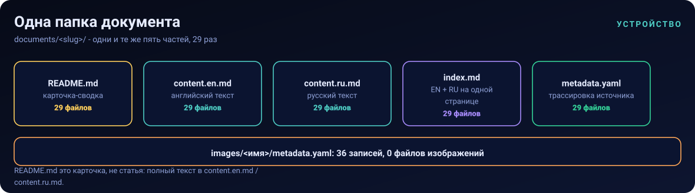

# Структура и как её читать

[Руководство](README.ru.md) · [English](NAVIGATION.md) · [Главная страница](../README.ru.md)

## С чего начать

1. Знаете тему: откройте [`topics/README.md`](../topics/README.md), выберите страницу темы, перейдите по ссылке к карточке документа.
2. Нужно всё в одной таблице: [`documents/README.md`](../documents/README.md).
3. Хотите читать: из карточки откройте `content.en.md` или `content.ru.md`; `index.md` показывает оба языка на одной странице.
4. Нужен источник: откройте `metadata.yaml` документа.

## Дерево папок

```
asrp.media-documents/
├── README.md, README.ru.md       # главные страницы (EN, RU)
├── metadata.yaml                 # машиночитаемые метаданные хаба
├── documents/
│   ├── README.md                 # полный каталог документов
│   └── <slug>/                   # папка на статью (29)
├── topics/                       # индекс тем + 9 страниц тем
├── guide/                        # эти страницы (EN + RU) и сгенерированные SVG
├── archive/                      # прежний README, байт в байт
├── tools/, tests/                # инструменты витрины и проверка без потерь
```



## Что в папке документа

| Файл | Что это |
|---|---|
| `README.md` | карточка-сводка: описание, статус/тип/id источника, даты публикации и обновления, ссылки |
| `content.en.md`, `content.ru.md` | полный текст на одном языке (29 + 29 файлов) |
| `index.md` | английский и русский тексты на одной странице (29 файлов) |
| `metadata.yaml` | трассировка: `source_id`, `source_status`, `source_type`, `topic_slug`, даты, `source_languages_migrated` (язык, `content_row_id`), `source_title`, `source_slug`, `images`, `traceability` |
| `images/<имя>/metadata.yaml` | запись об изображении: исходный путь, размер, ширина и высота, `binary_in_export: false`, `checksum: null` (36 записей, файлов изображений нет) |

## Как читать `metadata.yaml`

- `source_status: todo` или `published` — статус платформы, скопированный как есть; не считайте его состоянием проверки в этом репозитории.
- `deleted_at: '1969-12-31T23:00:00.000Z'` стоит во всех 29 записях; похоже на пустую дату, записанную как значение эпохи Unix (см. [OPEN-QUESTIONS.ru.md](OPEN-QUESTIONS.ru.md)).
- `non_migrated_languages` — числовые id языков строк источника, которые не мигрированы.
