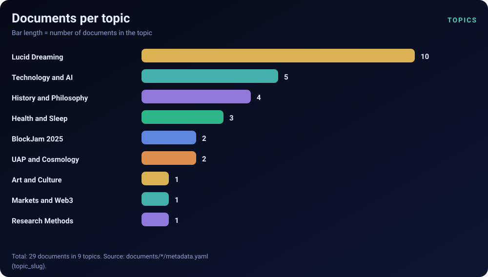

# Documents by topic

[Guide](README.md) · [Русский](TOPICS.ru.md) · [Front page](../README.md)

## The nine topics

Counts come from `topic_slug` in each `documents/<slug>/metadata.yaml`; every topic has a page in `topics/` that lists its documents.

| Topic | Documents | of which source status `published` | Page |
|---|---:|---:|---|
| Lucid Dreaming | 10 | 1 | [`topics/lucid-dreaming.md`](../topics/lucid-dreaming.md) |
| Technology and AI | 5 | 0 | [`topics/technology-and-ai.md`](../topics/technology-and-ai.md) |
| History and Philosophy | 4 | 0 | [`topics/history-and-philosophy.md`](../topics/history-and-philosophy.md) |
| Health and Sleep | 3 | 0 | [`topics/health-and-sleep.md`](../topics/health-and-sleep.md) |
| BlockJam 2025 | 2 | 1 | [`topics/blockjam-2025.md`](../topics/blockjam-2025.md) |
| UAP and Cosmology | 2 | 2 | [`topics/uap-and-cosmology.md`](../topics/uap-and-cosmology.md) |
| Art and Culture | 1 | 0 | [`topics/art-and-culture.md`](../topics/art-and-culture.md) |
| Markets and Web3 | 1 | 0 | [`topics/markets-and-web3.md`](../topics/markets-and-web3.md) |
| Research Methods | 1 | 0 | [`topics/research-methods.md`](../topics/research-methods.md) |
| **Total** | **29** | **4** | [`topics/README.md`](../topics/README.md) |

## Source type and source status

`source_type` and `source_status` are copied from the platform export. `published` and `todo` are the platform's own values; this repository does not say what `todo` means (see [OPEN-QUESTIONS.md](OPEN-QUESTIONS.md)).

| Source type | `published` | `todo` | Total |
|---|---:|---:|---:|
| `interview` | 3 | 15 | 18 |
| `article` | 1 | 8 | 9 |
| `research` | 0 | 2 | 2 |
| **Total** | **4** | **25** | **29** |

## Other facts from the metadata

- Every document has an English and a Russian body; the 29 `index.md` pages show both.
- All 29 records have `active: true`, `premium: false`, `exclusive: false`; `free: true` for 5 of them.
- `publication_date` runs from 2023-03-10 to 2025-12-09 (20 of the 29 dates fall in 2023, 3 in 2024, 6 in 2025).
- The full per-document list (title, type, status, topic, languages, source id) is [`documents/README.md`](../documents/README.md); titles are not repeated here.
