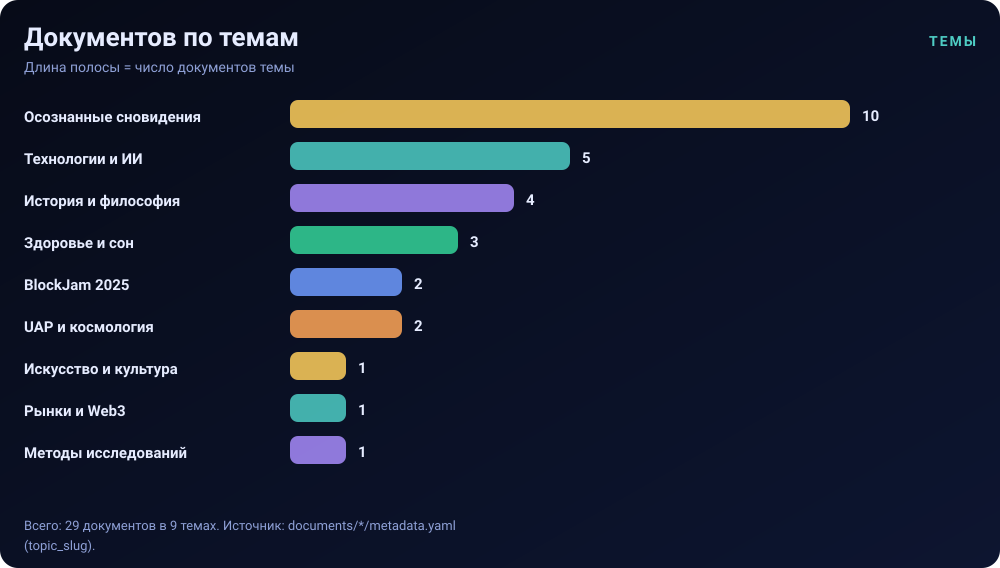

# Документы по темам

[Руководство](README.ru.md) · [English](TOPICS.md) · [Главная страница](../README.ru.md)

## Девять тем

Числа взяты из `topic_slug` в каждом `documents/<slug>/metadata.yaml`; у каждой темы есть страница в `topics/` со списком документов.

| Тема | Документов | из них статус источника `published` | Страница |
|---|---:|---:|---|
| Осознанные сновидения | 10 | 1 | [`topics/lucid-dreaming.md`](../topics/lucid-dreaming.md) |
| Технологии и ИИ | 5 | 0 | [`topics/technology-and-ai.md`](../topics/technology-and-ai.md) |
| История и философия | 4 | 0 | [`topics/history-and-philosophy.md`](../topics/history-and-philosophy.md) |
| Здоровье и сон | 3 | 0 | [`topics/health-and-sleep.md`](../topics/health-and-sleep.md) |
| BlockJam 2025 | 2 | 1 | [`topics/blockjam-2025.md`](../topics/blockjam-2025.md) |
| UAP и космология | 2 | 2 | [`topics/uap-and-cosmology.md`](../topics/uap-and-cosmology.md) |
| Искусство и культура | 1 | 0 | [`topics/art-and-culture.md`](../topics/art-and-culture.md) |
| Рынки и Web3 | 1 | 0 | [`topics/markets-and-web3.md`](../topics/markets-and-web3.md) |
| Методы исследований | 1 | 0 | [`topics/research-methods.md`](../topics/research-methods.md) |
| **Всего** | **29** | **4** | [`topics/README.md`](../topics/README.md) |

## Тип и статус источника

`source_type` и `source_status` скопированы из экспорта платформы. `published` и `todo` — значения самой платформы; что значит `todo`, репозиторий не говорит (см. [OPEN-QUESTIONS.ru.md](OPEN-QUESTIONS.ru.md)).

| Тип источника | `published` | `todo` | Всего |
|---|---:|---:|---:|
| `interview` | 3 | 15 | 18 |
| `article` | 1 | 8 | 9 |
| `research` | 0 | 2 | 2 |
| **Всего** | **4** | **25** | **29** |

## Другие факты из метаданных

- У каждого документа есть английский и русский тексты; 29 страниц `index.md` показывают оба.
- У всех 29 записей `active: true`, `premium: false`, `exclusive: false`; `free: true` у 5.
- `publication_date` — от 2023-03-10 до 2025-12-09 (20 из 29 дат в 2023 году, 3 в 2024, 6 в 2025).
- Полный список документов (название, тип, статус, тема, языки, исходный id) — [`documents/README.md`](../documents/README.md); названия здесь не повторяются.
